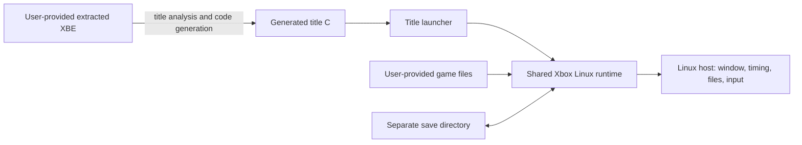

# Xbox Linux

Xbox Linux is the shared Linux host/runtime layer for independent Original Xbox recompilation projects. It pins and patches the upstream [`xboxrecomp`](https://github.com/sp00nznet/xboxrecomp) framework, defines a reproducible Linux build environment, and provides the scripts that fetch and build that framework.

It is a reusable dependency, not a game port by itself. It contains no title executable, game assets, generated title code, or title-specific entry point. Each game has a separate repository that supplies those pieces and links against the runtime:

- [Star Wars: Obi-Wan Recomp](https://github.com/soltros/obiwan-recomp)
- [Unreal Championship 2 Recomp Research](https://github.com/soltros/uc2-recomp)

## What happens when a game runs

The upstream framework translates Xbox x86 code into C functions ahead of time. A title project runs that analysis/generation pipeline for its own XBE, builds the generated C together with a small title launcher, then links the result to the shared runtime. The launcher passes the extracted game directory and a separate save directory to the host program. At startup the runtime validates and maps the XBE image, constructs the Xbox guest memory layout, installs host fault handling, initializes kernel bridges and device models, and calls the translated guest entry point.



The generated C preserves guest CPU state in runtime-managed registers and guest memory. Calls to Xbox kernel imports are dispatched to host implementations of the corresponding kernel services (or explicit stubs while bring-up is in progress). The runtime also supplies the Xbox memory and device interfaces the translated code expects. It is therefore a translation plus compatibility runtime, not a general-purpose Xbox emulator: it does not interpret every XBE instruction dynamically, and each title still needs code discovery, translation, entry setup, and compatibility work.

## What the shared runtime provides

The pinned framework includes the common host and Xbox-facing components used by title builds: guest memory layout and address conversion; kernel import bridges, thread and synchronization support, and Xbox path/file handling; host-window/video and audio integration; and Xbox graphics/device code, including NV2A pushbuffer processing and USB OHCI support. The Linux patch in this repository adapts framework behavior that the title work has needed on Linux x86-64. In particular, it adds safe guest address-space placement, x86-64 MMIO fault decoding for the OHCI model, case-insensitive resolution of existing Xbox-style paths on case-sensitive Linux filesystems, and bounded opt-in thread/DPC diagnostics.

The GPU path is still under development. It can process real title command streams, but the current implementation reports unhandled NV2A methods and is not a complete GPU implementation. Vulkan is the graphics target for this runtime and future title projects. The present host NV2A path transforms and rasterizes on the CPU, and SDL currently presents its framebuffer through the host SDL renderer; adding Vulkan only at the window boundary would not implement Xbox GPU behavior or fix incorrect title rendering. See [the Vulkan migration plan](docs/VULKAN-MIGRATION.md) for scope and validation gates. A successful compile or a rendered splash/menu frame is evidence for that particular path only; it does not establish full visual correctness or gameplay compatibility.

## Install and build

Requirements: x86-64 Linux, Git, and Nix with flakes enabled. The flake pins the Nixpkgs revision and provides CMake, Ninja, compilers/debug tools, Python with Capstone/Pytest, SDL2, Vulkan headers/loader/tools/validation layers and shaderc, plus the current OpenGL/Epoxy transition dependencies, OpenSSL, and FFmpeg development dependencies.

The normal one-command setup fetches the exact upstream revision in `toolchain.json`, applies the local Linux patch, configures the framework, and builds it:

```sh
git clone https://github.com/soltros/xbox-linux.git
cd xbox-linux
./tools/install_runtime.sh
```

The fetched framework is placed in ignored `third_party/xboxrecomp/`; CMake output is placed in ignored `build/runtime/`. These are local build dependencies, not vendored files in this repository. The installer accepts `JOBS=8` to set build parallelism.

For individual steps or diagnosis:

```sh
nix develop
python3 tools/toolchain.py fetch
python3 tools/toolchain.py check
cmake -S third_party/xboxrecomp -B build/runtime -G Ninja -DCMAKE_BUILD_TYPE=Debug
cmake --build build/runtime --parallel 4
```

`fetch` verifies the pinned Git commit before applying the patch. It is safe to rerun when the checkout is already at that commit; it refuses to alter a different existing checkout. `check` writes `reports/toolchain-preflight.json` and reports host tools, libraries, Python Capstone, and whether the pinned checkout exists. Run it after `fetch`; it is an environment probe, not a game compatibility test. `patch` can re-apply/check the Linux patch separately.

For a shareable title run log, use [`tools/run_diagnostics.sh`](tools/run_diagnostics.sh). It launches the title in its normal window, records runtime output and host/display details, then packages a filtered summary and the full log. See [Capturing a title run](docs/DIAGNOSTICS.md) for timeouts and output locations. The wrapper creates the save directory and excludes game and save contents from the bundle.

For the usual Obi-Wan checkout layout, run `./diagnostic.sh` from this repository root. It finds the title launcher and extracted game directory automatically; environment variables can override either path.

## Using it from a title project

Title builds consume the framework as a separate dependency. For a sibling checkout, the default path is `../xbox-linux/third_party/xboxrecomp`; otherwise set `XBOXRECOMP_DIR` to that framework directory. Title setup scripts can call `tools/install_runtime.sh` before configuring their own launcher. For example, the Obi-Wan project installer fetches/builds this runtime, then generates and builds Obi-Wan's title-specific code. The UC2 project currently uses the same environment for static analysis; it does not yet have a runnable UC2 recompilation target.

The runtime never needs a game's copyrighted files committed to this repository. Keep an extraction and save data local, and pass their paths to the title launcher as its documentation describes.

## Current scope and limits

The project targets Linux x86-64 bring-up. A runtime library build proves that the shared code compiles; it does not prove a title starts, renders correctly, accepts input, saves correctly, or is playable. Compatibility is title-specific and incomplete Xbox kernel, graphics, audio, and device behavior will surface during execution. Use title project status notes for the latest evidence and known gaps.

## License boundaries

Original project code in this repository is GPL-3.0-only; see [LICENSE](LICENSE). The framework is fetched from upstream at the exact revision in `toolchain.json` and retains its upstream license. No Xbox executable, extracted content, save data, or game-specific generated C is included here.
